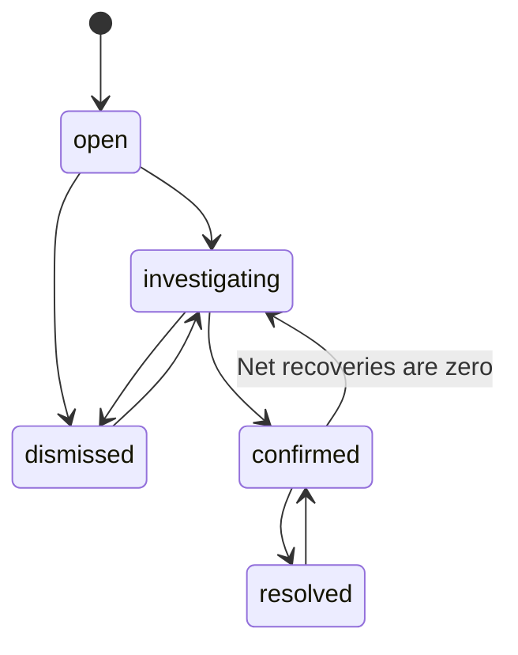

# Phase 3 architecture

| Module | Responsibility |
|---|---|
| workflow.py | Pure monetary input rules, recovery bounds and status-transition policy |
| cases.py | Idempotent detection, evidence snapshots, tenant-scoped queries, transactional case actions and ledger |
| cases_page.py | Review queue, filters, evidence, forms, activity history and metrics |
| sql/003_investigations.sql | Confirmation/version metadata, reversal links, action keys and append-only event trigger |
| scripts/migrate_db.py | Ordered 002/003 migrations under a migration lock |

## State transitions

A reason is required for status changes. Confirmation requires a positive amount at most equal to the finding's potential loss. Resolution with an unrecovered balance requires an explicit choice and reason. A resolved case can be reopened to record a correction.

## Financial definitions

Potential underbilling is the original rule output. Confirmed amount is the reviewer-supported amount. Net recorded recoveries equal recovery events minus reversal events. Confirmed outstanding equals confirmed amount minus net recorded recoveries, including balances on closed cases. These figures are kept separate; a status transition alone never records money.

Money uses Decimal in Python and NUMERIC in PostgreSQL. Migration 003 widens finding/event amounts to NUMERIC(24,2), accommodating large quantity × unit-price products accepted by the import contract. Unit-price precision is unchanged. UI floats are used only for table display; ledger actions accept exact text inputs and validate at most two decimal places.

## Persistence and consistency

Detection reads one enriched candidate view and captures the source invoice/order/customer/product values plus available source batch/row IDs. The view enriches the original rule in one join graph, avoiding repeated joins back through the candidate view. Findings are unique by tenant, rule, rule version and invoice line. ON CONFLICT DO NOTHING prevents rescans from resetting investigation decisions. Current source comparisons remain independent of the captured evidence. External source corrections and future rule-version replacement need a separate reconciliation design; current metrics select the one active rule/version.

Each case action starts one database transaction, locks the finding with SELECT FOR UPDATE, checks the caller's displayed version, validates policy, writes a ledger/activity event and increments the version. Any failure rolls back all changes. A request key and payload fingerprint prevent replaying one logical action as a second recovery. Reusing a request key with different details is rejected. Duplicate active recovery references within a case are rejected.

Reversals reference an original event on the same tenant and finding. The service checks that it is an active recovery and reverses its full amount. A partial unique index permits only one reversal per original event. Events are append-only through a trigger; corrected entries add new events. Identity-backed event sequence numbers establish a stable order when timestamps are equal.

Row locks and versions coordinate application case actions; the per-tenant detection lock is shared with imports. Cross-row recovery bounds and valid transitions are service policies. Direct database-owner SQL can bypass application policy or disable triggers, so this is not an authenticated or tamper-proof accounting system. Deploying for multiple companies still requires verified membership, least-privilege roles, authorization/row-security tests, protected audit privileges, backups and operational controls.

The portfolio implementation loads a small review queue in memory. Production scale should paginate/filter in SQL and calculate aggregate metrics server-side. There is no automatic transfer of money or bank verification.

Primary API references used: https://www.postgresql.org/docs/18/sql-insert.html and https://docs.streamlit.io/develop/concepts/architecture/forms .
